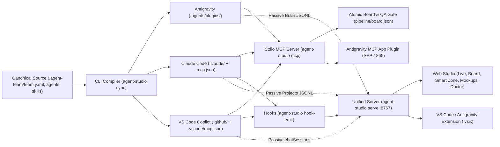

# Agent Studio

[](https://github.com/jakehesson/agent-studio/actions/workflows/ci.yml)
[](LICENSE)
[](CHANGELOG.md)
[](package.json)

**IDE-agnostic multi-agent orchestration, QA-gated Agile Board MCP, and unified live monitoring studio** for **Antigravity**, **Claude Code**, and **GitHub Copilot / VS Code**.

Author your team roster, skills, workflow guardrails, and verification checkpoints once in `.agent-team/`—compile them deterministically across every IDE with SHA-256 drift detection, enforce strict QA gates via stdio MCP + `PreToolUse` hooks, and monitor every multi-agent session live from one local Web Studio, IDE extension, or native Antigravity MCP App.

---

## Core Capabilities

1. **CLI & Cross-IDE Compiler (`init`, `sync`, `doctor`, `models`, `board`, `serve`, `mcp`):** Compiles a single canonical `.agent-team/` manifest into native plugin, subagent, skill, rule, MCP, and hook files for **Antigravity**, **Claude Code**, and **GitHub Copilot / VS Code** with non-destructive merging and CI drift checks (`sync --check`).
2. **3-Layer Updatable Model Index & Per-Role Model Routing:** Routes `fast` / `balanced` / `reasoning` tiers and `defer-to-host` / `prefer-fallback` / `pinned` policies across Antigravity (`/swarm`), Claude Code (`/model`), and VS Code Copilot (Fusion / Auto + live `vscode.lm` catalog sync) via `.agent-team/model-index.json` and `agent-studio models`.
3. **QA-Gated Agile DevOps Board MCP:** Manages `ready -> design -> dev -> test -> done` workflows in `pipeline/board.json` with atomic file locking (`board.json.lock`), `PreToolUse` edit guardrails, and a server-enforced `testrun` gate that blocks `test -> done` transitions until checkpoints pass.
4. **Unified Web Studio + Galaxy Z Fold 7 Three-Tier Responsive UI:** Single-port local studio (`8767`) featuring a non-overlapping SVG agent topology mesh, video-style timeline scrubber (`● LIVE` pinning + historical replay), human-readable activity stream, Agile Kanban board, Agent Team & Model Index editor, Mockups gallery, and Doctor panel—engineered for Cover (`< 640px`), Unfolded Dual-Pane (`640px–1020px` with `@media (horizontal-viewport-segments: 2)` hinge alignment), and Desktop (`>= 1021px`).
5. **VS Code & Antigravity `.vsix` Extension:** Embedded Activity Bar sidebar, Status Bar telemetry pill, Command Palette onboarding, live `vscode.lm` model discovery, and full-bleed Webview Studio panel with automatic host-IDE and workspace scoping (`?embed=1`) plus daemon-friendly coexistence.
6. **Native Antigravity MCP App Plugin (SEP-1865):** Zero-HTTP-server native plugin supporting Antigravity's auxiliary side pane (`aux_pane`), left sidebar (`global`), and inline `open_studio` tool rendering over `postMessage` JSON-RPC with live theme sync.
7. **Token & Context Smart Zone Dashboard:** Live per-agent context window pressure meters, smart-zone thresholds, model breakdowns, and token usage telemetry across sessions.
8. **Legacy Python Fallback:** Zero-dependency Python 3 visualizer (`agent_visualizer.py`) and smoke suite (`tests/smoke_test.py`) preserved at the repository root for lightweight local runs.

---

## Quick Start

### Install & Build from Source

```bash
git clone https://github.com/jakehesson/agent-studio.git
cd agent-studio
npm install
npm run check
npm run build:all

# Optional: link `agent-studio` globally so external repositories can invoke it before npm publication
# (otherwise invoke `node <path-to-agent-studio>/dist/cli/index.js ...`)
npm link
```

### Initialize a Workspace & Compile IDE Adapters

```bash
# Interactive setup in any repository (scaffolds .agent-team/ + pipeline/board.json)
npx agent-studio init

# Non-interactive setup for all three IDEs
npx agent-studio init --ides antigravity,claude-code,copilot-vscode --non-interactive

# Install the global team-setup agent once for Antigravity, Claude Code, and VS Code
npx agent-studio init --global

# Recompile after editing .agent-team/ and verify zero drift
npx agent-studio sync
npx agent-studio sync --check
npx agent-studio doctor
```

### Launch the Web Studio or Run Stdio MCP

```bash
# Start the unified Web Studio on http://127.0.0.1:8767
npx agent-studio serve --open

# Bind all interfaces for mobile / Galaxy Z Fold 7 / Tailscale access
npx agent-studio serve --host 0.0.0.0 --port 8767

# Start the stdio JSON-RPC 2.0 MCP server (auto-detects project from cwd)
npx agent-studio mcp
```

---

## Architecture Overview



### Core Invariants
- **Single Canonical Source (`.agent-team/`):** Edit roles (`orchestrator`, `architect`, `ux-designer`, `backend-engineer`, `frontend-engineer`, `qa-validator`, `team-setup`), skills, and checkpoints once; `agent-studio sync` preserves user Markdown outside `<!-- agent-studio:begin/end -->` fences and existing MCP/hook JSON keys.
- **Defense-in-Depth Guardrails:** Read-only `orchestrator` tool allowlists (`orchestratorReadOnly: true`), sub-200ms `PreToolUse` hooks blocking raw edits to `pipeline/board.json` (exit code `2`), and server-side MCP QA Gate checks on `test -> done`.
- **Zero External Network Dependencies:** Local Node.js (`>= 20.0.0`) runtime, locked atomic `pipeline/board.json` storage, and pre-bundled static Web Studio assets (`dist/web/`).

---

## CLI Command Reference

| Command | Summary | Key Flags |
| :--- | :--- | :--- |
| `agent-studio init` | Scaffold `.agent-team/` & `pipeline/board.json` (preserving existing boards), register workspace, compile adapters, run `doctor` | `--project <dir>`, `--ides <csv>`, `--global`, `--non-interactive`, `--force`, `--id`, `--title`, `--json` |
| `agent-studio sync` | Deterministically compile `.agent-team/` into enabled IDEs with non-destructive merging | `--project <id\|dir>`, `--ides <csv>`, `--check` (CI drift gate), `--json` |
| `agent-studio doctor` | Validate Node version, `team.yaml`, adapter drift hashes, MCP configs, IDE hooks, and telemetry directories | `--project <id\|dir>`, `--json` |
| `agent-studio serve` | Launch the unified single-port Web Studio (REST + SSE + static UI) | `--port 8767`, `--host 127.0.0.1`, `--open`, `--brain-dir`, `--claude-dir`, `--vscode-dir`, `--mockup-dir` |
| `agent-studio mcp` | Run the stdio JSON-RPC 2.0 MCP server (`projects`, `board`, `testrun`, `telemetry`) | `--project <id\|path>`, `--session-id <uuid>` |
| `agent-studio hook-emit` | Fast IDE hook telemetry emitter & `PreToolUse` board-edit guardrail (`< 200ms` offline fallback) | `--ide <claude-code\|copilot-vscode>`, `--event <PreToolUse\|PostToolUse\|SubagentStart\|SubagentStop\|Stop>`, `--port <N>` |
| `agent-studio board <op>` | Manage sprint backlog & lifecycle (`status`, `next`, `show`, `add`, `move`, `note`, `owner`, `plan`, `gate`, `report`) | `--project <id\|path>`, `--actor <role>`, `--json` |
| `agent-studio testrun <op>` | Run and record QA verification checkpoints (`start`, `record`, `step`, `close`, `list`) | `--project <id\|path>`, `--suite <name>`, `--json` |
| `agent-studio models <op>` | Inspect and update the 3-layer Model Index & per-role routing (`show`, `set-tier`, `set-role`, `set-policy`, `upsert`, `discover`, `adopt`, `reset`) | `--project <id\|dir>`, `--ide <ide>`, `--tier <tier>`, `--sync`, `--json` |
| `agent-studio projects <op>` | Manage registered workspaces in `~/.agent-studio/projects.json` (`list`, `register`, `info`) | `--id`, `--title`, `--root`, `--default`, `--json` |

---

## Documentation Index

| Document | Description |
| :--- | :--- |
| [Day-to-Day Usage & Workflow Guide](docs/USAGE.md) | Sprint lifecycle, Orchestrator dispatch loop, three-layer QA Gate, Web Studio controls, and migrating existing boards. |
| [Multi-IDE Integration Matrix](docs/IDE_INTEGRATION.md) | Side-by-side comparison of compiled files, MCP wiring, hooks, model routing, and telemetry across all three IDEs. |
| [Antigravity Usage Guide](docs/guides/ANTIGRAVITY.md) | Plugin bootstrap, workspace reload, `orchestrator` & `team-setup` prompts, brain JSONL discovery, and troubleshooting. |
| [Claude Code Usage Guide](docs/guides/CLAUDE_CODE.md) | `.mcp.json` approval, `@team-setup` & `@orchestrator` delegation, `CLAUDE.md` managed blocks, hooks, and deduplication. |
| [GitHub Copilot / VS Code Usage Guide](docs/guides/COPILOT_VSCODE.md) | `.vscode/mcp.json` startup, custom `.agent.md` agents with `handoffs:`, hooks, and `chatSessions` fallback monitoring. |
| [VS Code & Antigravity IDE Extension (`.vsix`)](docs/IDE_EXTENSION.md) | Installing, configuring, scoping, and packaging `extension/agent-studio-<version>.vsix`. |
| [Native Antigravity MCP App Plugin](docs/ANTIGRAVITY_APP_PLUGIN.md) | Building and installing the zero-server SEP-1865 plugin (`aux_pane`, `global`, `open_studio`). |
| [AI Setup Agent & Customization Guide](docs/SETUP_AGENT.md) | Global/project onboarding with `team-setup`, customizing `.agent-team/team.yaml`, drift checks, and `doctor`. |
| [Telemetry & API Specification](docs/TELEMETRY_SPEC.md) | `NormalizedEvent` schema, passive IDE adapters, deduplication, 6-state machine, and HTTP/SSE API contracts. |
| [Model Routing & Index Spec](docs/specs/model-routing-and-index.md) | Technical specification for 3-layer `model-index.json`, per-role model policies, and host compatibility. |
| [Changelog](CHANGELOG.md) | Release history and version notes (`0.8.1`). |
| [Contributing](CONTRIBUTING.md) | Development setup, verification checkpoints, and pull request guidelines. |
| [Security Policy](SECURITY.md) | Vulnerability reporting and local-first security posture. |
| [License](LICENSE) | MIT License (`Jake Hesson`). |

---

## Local Verification & Legacy Python Fallback

```bash
# TypeScript typecheck, unit/integration tests, and Web Studio bundle
npm run check
npm test
npm --prefix web run check
npm --prefix web run build
```

For zero-dependency Python 3 fallback monitoring:

```bash
python agent_visualizer.py --port 8767 --open
python tests/smoke_test.py
```
